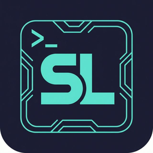
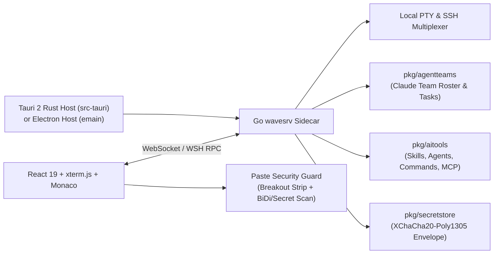

<p align="center">
  <a href="https://github.com/SalyyS1/SLTerm">
    
  </a>
</p>

<h1 align="center">SLTerm</h1>

<p align="center">
  <strong>AI-Native Graphical Terminal Workspace on Tauri 2, Go, and xterm.js</strong>
</p>

<p align="center">
  <a href="https://github.com/SalyyS1/SLTerm/actions/workflows/ci.yml"></a>
  <a href="https://github.com/SalyyS1/SLTerm/releases"></a>
  <a href="https://github.com/SalyyS1/SLTerm/blob/main/LICENSE"></a>
  <a href="https://github.com/SalyyS1/SLTerm/releases"></a>
</p>

---

SLTerm is an open-source graphical terminal workspace engineered for multi-agent AI coding workflows, low-latency SSH operations, and low-footprint desktop execution. Forked from Wave Terminal and re-architected by Salyvn, SLTerm pairs a Go backend (`wavesrv` and `wsh`) with a native **Tauri 2 Rust shell** (`src-tauri/`) alongside Electron compatibility, plus first-class observability panels for Claude Code multi-agent teams, AI CLI skills, and Model Context Protocol (MCP) servers.

## Key Engineering Highlights

- **Dual Desktop Runtime (Tauri 2 Rust Host + Electron):** Ships a native Rust Tauri 2 host (`src-tauri/`) that spawns `wavesrv` as a managed sidecar on Windows, macOS, and Linux, cutting idle WebView memory overhead compared to Chromium-bundled shells while retaining Electron builds for legacy workflows.
- **Claude Code Multi-Agent Teams Board (`pkg/agentteams`):** Read-only real-time observability view over live Claude Code team rosters (`config.json`) and shared task boards (`blockedBy` dependencies, task owners, active execution states, and explicit schema-drift warnings).
- **AI CLI & MCP Inventory (`pkg/aitools`):** Unified inspector and editor for user-scope and project-scope Skills, Agents, Slash Commands, and MCP server definitions (`stdio` and `http` transports) across Claude Code and Codex, hardened against path-traversal (`validateName`).
- **Terminal Paste Security Guard (`frontend/app/view/term/paste-guard.ts`):** Intercepts clipboard pastes before `xterm.js` ingestion, unconditionally stripping 7-bit (`ESC[201~`) and 8-bit C1 (`0x9B 201~`) bracketed-paste breakout payloads while emitting secret-redacted warnings for ANSI/CR pastejacking escape smuggling, Trojan Source Unicode BiDi overrides (`U+202A..U+202E`, `U+2066..U+2069`), and live credential exposure (OpenAI, Anthropic, GitHub PAT, AWS IAM, Slack, and PEM private keys).
- **XChaCha20-Poly1305 Envelope Secret Store (`pkg/secretstore`):** Seals stored SSH and API credentials with 24-byte random-nonce authenticated encryption (`SLTERM-SECRETS-1:`), decoupling secret storage from Electron `safeStorage` so credentials migrate cleanly to the Tauri 2 runtime.
- **Zero-Ghost Terminal Layout & Replay Pipeline:** Pre-layout spawn gating (`term-spawn-gate.ts`) blocks premature `2x1` PTY starts prior to CSS box layout; carried terminal parking (`term-carry-over.ts`), loopback offset reconciliation (`term-replay.ts`), and batched frame/input writers (`term-batched-writer.ts`) keep high-throughput output smooth.
- **Workspace Blocks & Remote SSH:** Drag-and-drop tiled terminals, Monaco code editors, Markdown/CSV/PDF/media previews, web blocks, `wsh` workspace CLI control, and one-click SSH + remote filesystem sessions.
- **Bilingual Interface (English & Vietnamese):** Instant runtime language switching in `Settings -> Language` without restarting PTY sessions.

## Architecture



## Installation

Download prebuilt installers for your platform from [**GitHub Releases**](https://github.com/SalyyS1/SLTerm/releases):

| Platform | Tauri 2 Native Shell (`tauri-v*`) | Electron Build (`v*`) |
| :--- | :--- | :--- |
| **Windows (x64)** | `SLTerm_*_x64-setup.exe` (NSIS) | `SLTerm-win32-x64-*.exe` / `.zip` |
| **macOS (Apple Silicon / Intel)** | `SLTerm_*_aarch64.dmg` | `SLTerm-darwin-arm64-*.zip` / `x64` |
| **Linux (x86_64)** | `SLTerm_*_amd64.deb` / `.rpm` | `SLTerm-linux-x86_64-*.AppImage` / `.deb` |

> **Note for macOS:** Unsigned builds require right-click -> **Open** on first launch, or clearing the quarantine attribute via `xattr -dr com.apple.quarantine /Applications/SLTerm.app`.

### Minimum System Requirements

- **Windows:** Windows 10 version 1809 or later (x64, WebView2 runtime for Tauri builds)
- **macOS:** macOS 11 Big Sur or later (`arm64` or `x64`)
- **Linux:** `glibc >= 2.28` (Ubuntu 20.04+, Debian 10+, RHEL 8+); `webkit2gtk-4.1` for Tauri `.deb`/`.rpm` packages

## Building and Testing from Source

### Prerequisites

- **Go** `1.25+` (with CGO enabled for SQLite state persistence)
- **Node.js** `22+` and `npm`
- **Rust** `stable` toolchain (required when building the Tauri 2 native shell)

### Commands

```bash
git clone https://github.com/SalyyS1/SLTerm.git
cd SLTerm

# Install frontend dependencies
npm install

# Run frontend terminal unit tests (Vitest)
npx vitest run frontend/app/view/term/tests/

# Run Go backend unit tests
go test -race ./pkg/agentteams/... ./pkg/aitools/... ./pkg/secretstore/...

# Run Tauri 2 native desktop shell in development
npm run dev:tauri

# Build production Tauri 2 installer
npm run build:tauri

# Run Electron shell in development (optional fallback)
npm run dev
```

## Repository Layout

```text
SLTerm/
├── src-tauri/                  # Tauri 2 native Rust desktop shell & sidecar host
├── cmd/                        # Go binaries (wavesrv backend daemon, wsh CLI)
├── pkg/
│   ├── agentteams/             # Claude Code multi-agent team roster & task reader
│   ├── aitools/                # Skills, agents, slash commands & MCP config inspector
│   ├── secretstore/            # XChaCha20-Poly1305 authenticated credential store
│   ├── remote/                 # SSH client, agent forwarding & connection parser
│   └── shellexec/              # Local & remote PTY process lifecycle
├── frontend/
│   ├── app/view/term/          # xterm.js integration, paste-guard, replay & spawn gate
│   ├── app/view/agentteams/    # Multi-agent team observability UI
│   ├── app/view/aitools/       # AI CLI & MCP configuration UI
│   └── i18n/                   # English and Vietnamese localization bundles
└── emain/                      # Legacy Electron main process compatibility layer
```

## Related Developer & Security Tooling by Salyvn

- [**mcp-slim**](https://github.com/SalyyS1/mcp-slim): Zero-dependency CLI & stdio proxy that shrinks MCP tool schemas by ~66%, enforces tool allow/deny policies, and redacts leaked secrets with HMAC handles.
- [**SLClean**](https://github.com/SalyyS1/SLClean): Native Rust + Tauri 2 Windows developer cache & build-artifact cleaner with headless JSON CLI audit mode and WSL2/Docker `.vhdx` protection.
- [**foliora**](https://github.com/SalyyS1/foliora): Local-first Rust CLI and Tauri desktop app that converts technical PDFs into citation-grounded Markdown context packs.

## License

Licensed under the [Apache-2.0 License](LICENSE). Based on [Wave Terminal](https://github.com/wavetermdev/waveterm), customized and extended by [Salyvn](https://github.com/SalyyS1). See [ACKNOWLEDGEMENTS.md](ACKNOWLEDGEMENTS.md) for upstream credits.
